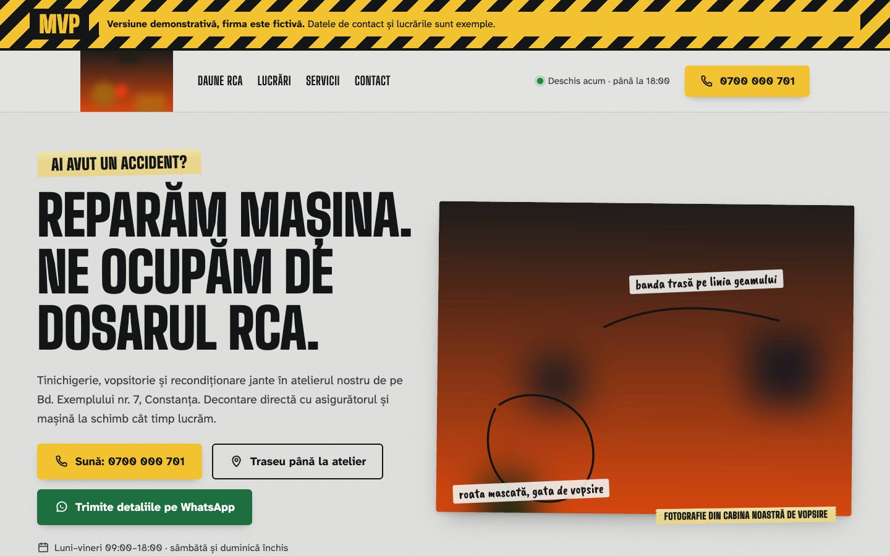
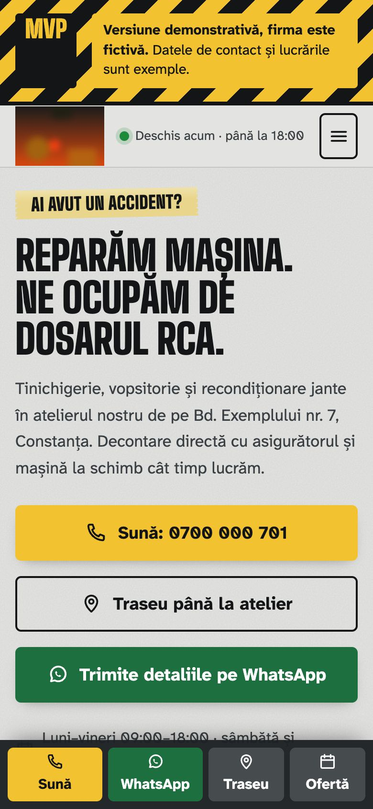
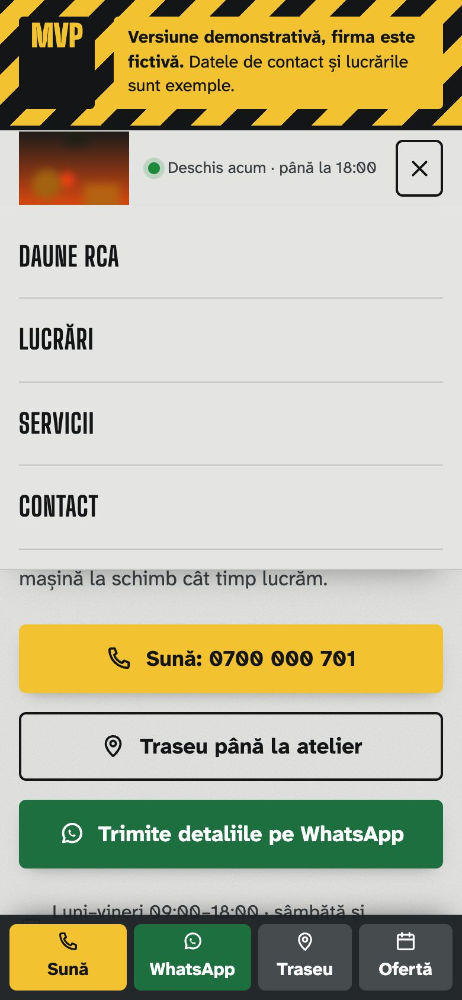
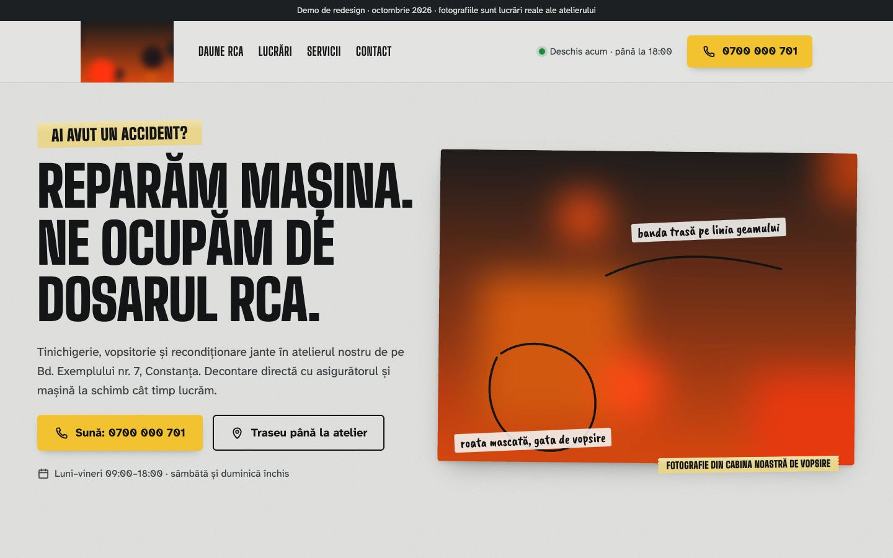

# Caroserie Lumen

Site de prezentare pentru tinichigerie și vopsitorie auto, în trei variante.

> Proiect demonstrativ. Firma, adresa, telefoanele, emailurile și recenziile sunt fictive. Orice asemănare cu o firmă reală este întâmplătoare.

## Capturi de ecran

| Prima pagină, telefon | Meniul pe telefon | Varianta 1 |
|---|---|---|
|  |  |  |

## Tehnologii

HTML, CSS și JavaScript simplu, în trei variante de design.

## Decizii tehnice

- Trei variante (`var1`, `var2`, `proiect/demo`) ale aceluiași site, pentru comparație.
- Comparatorul „înainte / după” pentru lucrările de tinichigerie funcționează și de la tastatură.
- Formularul păstrează o ciornă în localStorage, ca să nu se piardă textul la reîncărcare, și trimite cererea pe WhatsApp.
- Paginile legale (cookie-uri, confidențialitate, termeni) sunt scrise pentru acest site și descriu exact ce stochează el.
- Accesibilitate: link „Sari la conținut”, focus vizibil la navigarea cu tastatura.
- Animațiile se reduc sau se opresc pentru cine a setat „reducerea mișcării” în sistem (`prefers-reduced-motion`).
- Imaginile din afara ecranului se încarcă abia când e nevoie de ele (`loading="lazy"`).

## Rulare

Site static: deschide `index.html` în browser sau rulează un server local, de exemplu `npx serve .`.

## Cum a fost realizat

Proiectul a fost conceput și dezvoltat de Cristian Lucaci. În procesul de creație am folosit și instrumente de inteligență artificială, ca sprijin la scrierea codului, la texte și la verificări. Deciziile de design, alegerile tehnice și forma finală îmi aparțin.

## Licență

Codul este publicat sub licența [MIT](LICENSE), © 2026 Cristian Lucaci.

Resursele terțe incluse (fonturi, biblioteci, fotografii sau modele 3D cu licență liberă) își păstrează licențele proprii, menționate lângă fișiere sau în pagină. Imaginile fără sursă menționată sunt grafică generată pentru acest proiect.
